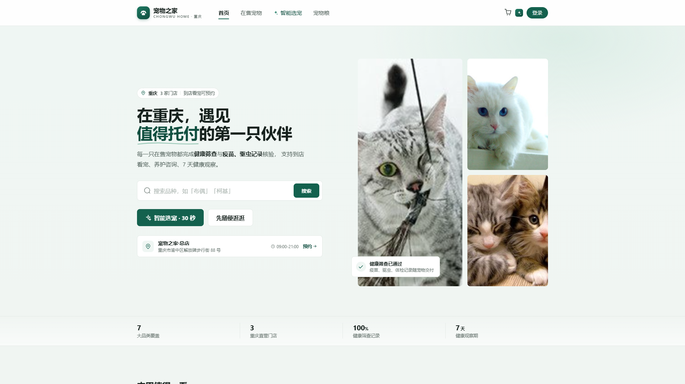
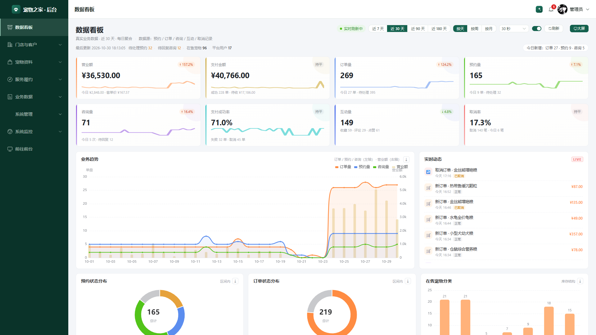
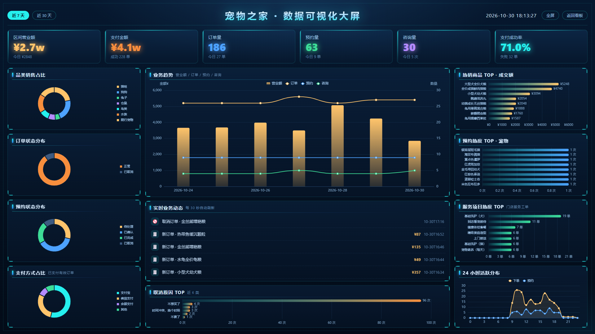

# 宠物之家（chongwupet）

基于 RuoYi 框架二次开发的宠物门店一体化系统：**前台宠物商城 + 门店服务预约 + AI 智能助手 + 运营后台 + 数据可视化大屏**，覆盖"看宠 → 下单 → 支付 → 预约 → 售后"完整业务闭环。

> 线上演示：商城 `http://47.116.73.25/shop/home` ｜ 后台 `http://47.116.73.25:8083`（即 `/admin`）

## 界面预览

**前台商城首页**



**运营后台 · 数据看板**



**可视化大屏（1920×1080，可从看板一键切换）**



## 功能总览

### 前台商城（`/shop/*`）

- **在售宠物**：首页筛选条、评分角标、宠物详情（健康记录、预约入口、社交互动）
- **宠物粮商城**：14 款在售粮，独立评论/点赞体系（与宠物评论通过 `target_type` 隔离）
- **购物车与订单**：结算收银台（支付宝 / 微信 / 余额三种通道，余额不足实时提示）、订单分组展示、未支付取消
- **门店服务预约**：自助预约不绑定宠物，支持联系人 / 地址 / 数量，免费项目自动确认，取消自动退款
- **AI 智能助手**：接入 Pollinations 免费大模型（OpenAI 兼容、免 Key），SSE 流式输出，意图路由（商品推荐 / 订单咨询 / 智能选宠 / 养宠知识），已支付订单卡片可点击直接发起咨询
- **钱包余额**：充值、支付、流水（失败流水保留真实原因）
- **站内通知**：支付成功 / 取消 / 预约状态变更实时推送，顶栏铃铛 60s 轮询 + 事件即时刷新
- **评分体系**：宠物与商品评分汇总，首页 / 商城卡片星级角标
- **登录态隔离**：前台 `Shop-Token` / 后台 `Admin-Token` 同源不同名，互不顶号

### 运营后台（`/admin`）

自研后台界面（非 RuoYi 默认 UI），静态菜单，登录后自动进入数据看板：

- **数据看板**：近 7 / 30 / 90 / 180 天切换、实时动态流、业务趋势、订单 / 预约 / 品类分布、热销 TOP 榜
- **可视化大屏**（`/admin/bigscreen`）：深色科技风大屏，1920×1080 设计稿等比缩放居中，12 个面板——KPI（营业额 / 支付金额 / 订单 / 预约 / 咨询 / 支付成功率）、四张环形图（品类 / 订单状态 / 预约状态 / **支付方式**）、业务趋势柱线混合图、实时业务动态、热销商品 / 预约热度 / **服务项目热度**三张 TOP 榜、**取消原因 TOP**、24 小时活跃分布；四角描边、扫描光束、标题流光等特效，60s 自动刷新
- **AI 咨询记录**：咨询问题分门别类（意图统计 KPI + 分类筛选），支持对话回放，15 秒静默轮询实时更新
- **业务管理**：宠物资料、商品、订单、预约工单（含支付方式 / 收款 / 应付列与筛选）、取消记录快照、用户管理、钱包流水
- **AI 助手降级链**：流式 → 非流式 → 本地模板兜底，免费档限流自动解析等待秒数重试

## 技术栈

| 层次 | 技术 |
| --- | --- |
| 后端 | Spring Boot（RuoYi-Vue）、MyBatis、JDK 17 |
| 数据库 | MySQL 8（库名 `ry-pet`）、Redis（验证码 / 缓存） |
| 前端 | Vue 3 + Vite + Element Plus + Pinia + ECharts（按需引入） |
| AI | Pollinations 免费大模型（OpenAI 兼容接口，`/pet/ai/stream` SSE 流式） |
| 部署 | 阿里云轻量服务器 + Nginx（静态 + 反代 `/dev-api`）+ systemd |

## 快速开始

```bash
# 1. 准备：MySQL 8 导入 sql/ 下的建表与种子脚本（库名 ry-pet），启动 Redis
# 2. 修改 ruoyi/ruoyi-admin/src/main/resources/application-druid.yml 数据源密码
# 3. 构建并启动后端（JDK 17）
bash build_backend.sh clean package -DskipTests
java -jar ruoyi/ruoyi-admin/target/ruoyi-admin.jar --server.port=8081

# 4. 构建前端
bash build_web.sh

# 5. 一键启动本地静态服务（生产包 + 预压缩 + API 反代）
bash start_all.sh
# 商城入口 http://localhost:82/shop/home ｜ 后台入口 http://localhost:83/admin
```

**演示账号**：`admin / admin123`（后台管理员）、`ry / admin123`（普通用户）

**演示数据**：`sql/seed_bigscreen_7days.sql` 可一键灌入近 7 天看板演示数据（订单 / 预约 / 服务工单 / 咨询 / 取消快照，统一 `create_by='seed7'` 标记，脚本尾部附清理语句）。

## 目录结构

```
├── ruoyi/                # 后端（RuoYi-Vue，Maven 多模块）
│   ├── ruoyi-admin/      #   启动模块 + Controller + 配置
│   └── ruoyi-system/     #   业务：宠物/订单/预约/AI 助手/钱包/通知等
├── pet-web/              # 前端（Vue 3）
│   ├── src/views/shop/   #   前台商城页面
│   ├── src/views/admin/  #   自研后台页面（含 dashboard / bigscreen / aichat）
│   └── src/components/   #   AI 助手（AssistantBlock / AssistantDock）等
├── sql/                  # 建表与种子脚本
├── deploy/               # 部署辅助脚本
├── build_backend.sh      # 后端构建
├── build_web.sh          # 前端构建（pet-web → dist-new，含 gzip 预压缩）
├── start_all.sh          # 本地一键启动
└── static-server.mjs     # 本地静态服务（生产包 + API 反代）
```

## 线上部署

- 后端：`/opt/pet/app/ruoyi-admin.jar`，systemd 服务 `pet`（8081，仅本机）
- 前端：`/opt/pet/web`（tar 原子替换），Nginx 80（商城）/ 8083（后台）反代 `^~ /dev-api/` → 8081
- 数据库：本机 MySQL 8（`pet` 账号）+ Redis

> 本项目为课程实践项目，演示账号与演示数据仅供学习交流。
